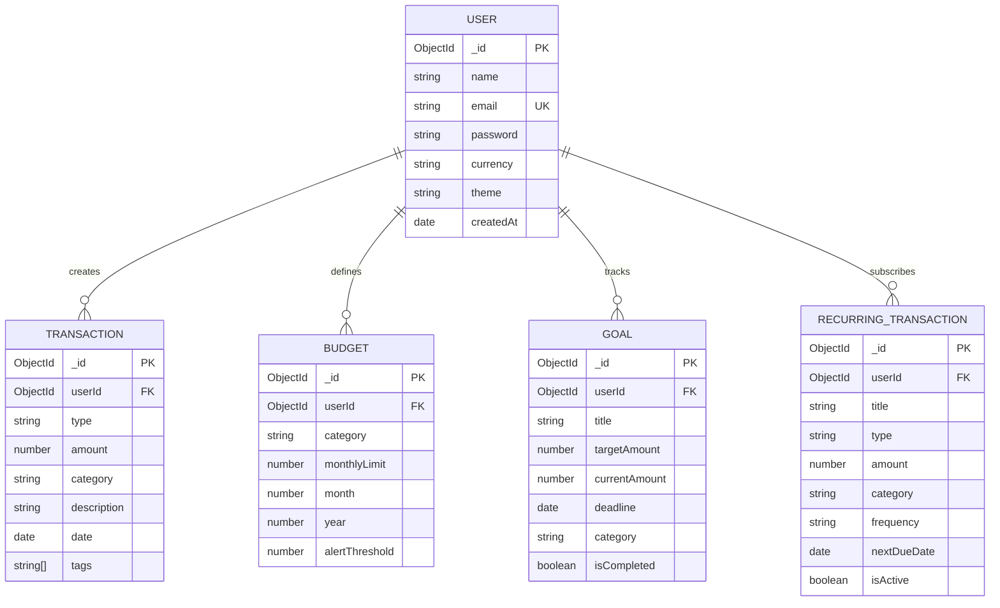

# 🗄️ Database Schema Specification

The application uses MongoDB Atlas with Mongoose object modeling.

## Collections & Relationships

## Compound Indexes
- **Transaction**: `{ userId: 1, date: -1 }`, `{ userId: 1, type: 1 }`
- **Budget**: `{ userId: 1, category: 1, month: 1, year: 1 }` (Unique constraint)
- **Goal**: `{ userId: 1, deadline: 1 }`
- **Recurring**: `{ userId: 1, nextDueDate: 1 }`
